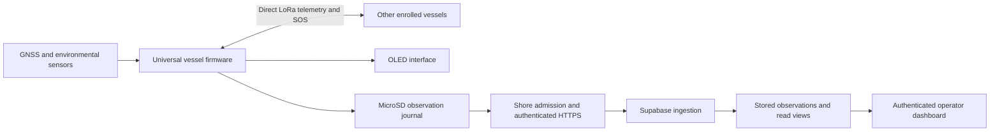

# System architecture

## Vessel to shore data flow

## Component boundaries

The LoRa path remains independent of the shore synchronization gate. Routine recording is controlled by the vessel recording mode; emergency/control capture and upload of retained records are separate from that selection. The macro and micro weather layers retain their own processing and timing. Capture time is distinct from server synchronization time.

The common firmware source lives in `firmware/universal/`; shared headers under `firmware/shared/` define the communication, hardware and storage contracts. Some historical compiler definitions and safety infrastructure remain to preserve the validated build configuration. They are not additional operational features.

The active database implementation is `supabase/migrations/` and `supabase/functions/ingest-study-sf/`, with its shared HTTP handler. `study_sf_records` is the stored journal record relation; `vessel_telemetry` and `weather_observations` provide typed read projections. The dashboard uses the existing authenticated access model; a demo display is not a source of real vessel measurements.

## System references

- [Firmware build and operation](../firmware/universal/README.md)
- [Enrollment and recovery](../firmware/universal/FLEET_ONBOARDING_AND_RECOVERY.md)
- [DTN recording and synchronization](../firmware/universal/DTN_STORE_AND_FORWARD.md)
- [Frontend configuration](../frontend/README.md)

The existing schema, API names, wire formats, device identity and persistent journal paths are compatibility contracts. Changing these requires separate review. Development tests and historical evidence are maintained outside the release tree.
