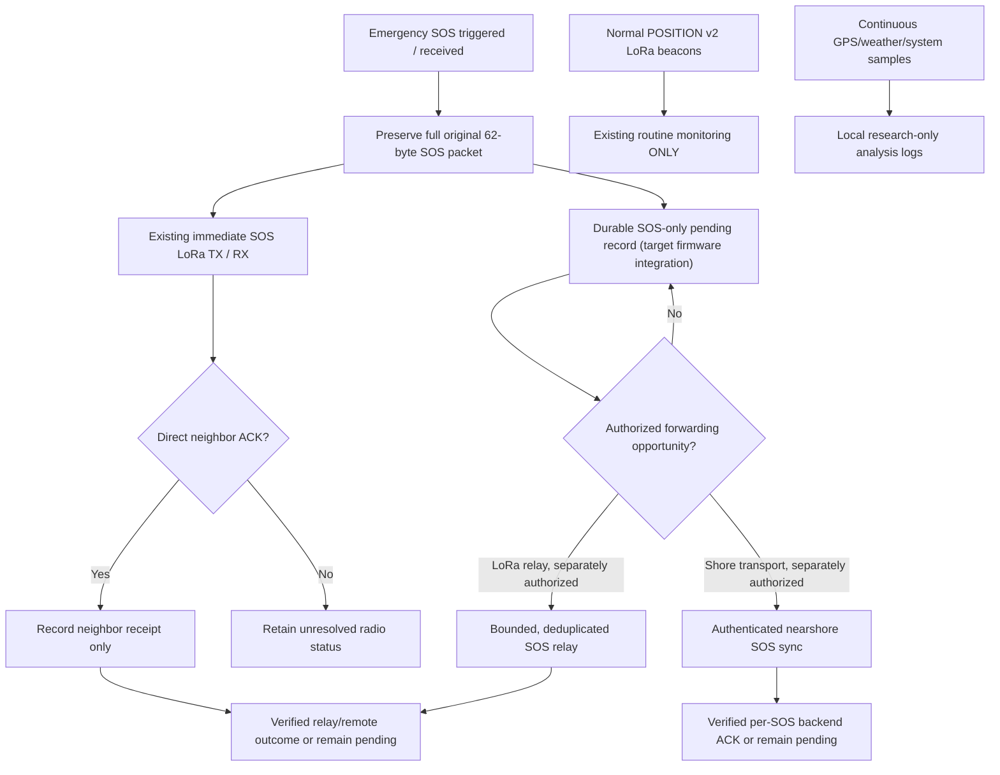

# THESIS — Corrected SOS-only DTN architecture and F24L executable host validation

**Revision:** 24 November 2026. **Accepted local parent:** `d19e585356a2788e2a6507d36ea87480f5639d51`, `feature/firmware-multihop` (reported locally committed and clean). **State:** source-verified architectural correction and standalone disposable-host prototype. **NOT:** actual firmware store-and-forward, SD media authorization, a real LoRa relay, a real shore-cloud uploader, or a Git commit.

## 1. Actual packet types: verified against GitHub code and commits

Read in repository `chollocaputol/B2B`, branch `feature/firmware-multihop`:

- [`firmware/shared/communication/packet_protocol.h`](https://github.com/chollocaputol/B2B/blob/feature/firmware-multihop/firmware/shared/communication/packet_protocol.h) — blob `c5ceccfda2eb86ae6aa1db23aa6461f93670ebac`; `VesselPacket` is exactly **62 packed bytes**. Types: `PACKET_TELEMETRY=1`, `PACKET_SOS=2`, `PACKET_SOS_ACK=3`, `PACKET_SOS_CANCEL=4`, `PACKET_SOS_CANCEL_ACK=5`. The SOS packet includes `originNodeId`, `sequenceNumber`, `timestamp`, `hopCount`, `flags`, `nodeName[12]`, `latitude_e7`, `longitude_e7`, `shoreDistance_m`, `batteryLevel`, and **full WeatherData** (`temperature_x10`, `humidity_x10`, `pressure_x10`, `pressureTrend_x10`, `zambrettiState`, `sensorFusionState`, `weatherState`), plus `message[8]`.
- [`firmware/universal/src/lora_manager.cpp`](https://github.com/chollocaputol/B2B/blob/feature/firmware-multihop/firmware/universal/src/lora_manager.cpp) — `createPacket()` fills the full packet from GPS/weather state; `transmitSOS()` reserves the emergency ID, calls `createPacket(pendingSOS,false)`, changes type to SOS and sends the preserved 62-byte packet. The **normal** `transmitPacket()` path by default encodes compact POSITION v2 instead. The SOS `timestamp` currently equals `millis()/1000` (**uptime, not guaranteed UTC**). `shoreDistance_m` currently defaults to **0** and `batteryLevel` to **100**, so neither is validated field measurement. Weather/position flags mark validity; missing measurements are not silently trusted.
- [`firmware/shared/communication/compact_position_v2.h`](https://github.com/chollocaputol/B2B/blob/feature/firmware-multihop/firmware/shared/communication/compact_position_v2.h) — default normal packet is **25 bytes**, conveying identity, sequence, uptime, GPS-fix flag and position only; **no weather payload** on the compact radio wire. Source change: [multi-vessel POSITION v2 commit `3ae9816`](https://github.com/chollocaputol/B2B/commit/3ae981604632a9d8ed3aa9632c7928327be9ef5b).
- [`firmware/shared/storage/thesis_sd_logger.h`](https://github.com/chollocaputol/B2B/blob/feature/firmware-multihop/firmware/shared/storage/thesis_sd_logger.h) — `queueEvent(...)` emits F06 JSONL event **metadata**: kind, local vessel, boot token/index, uptime, origin, sequence, result, RSSI/SNR, latitude/longitude, flags, hops, attempt. **It does not serialize the complete SOS `VesselPacket` or all weather readings.** This is the key gap for *actual* SOS packet store-and-forward and prohibits reconstructing a full SOS packet from an old F06 metadata row.
- [`lora_manager.cpp` receive state](https://github.com/chollocaputol/B2B/blob/feature/firmware-multihop/firmware/universal/src/lora_manager.cpp) — matching SOS ACK is **direct-neighbor receipt only**; it does not establish far-end forwarding or shore ingestion. Current legacy v1 SOS is explicitly marked unauthenticated. Physical V002 relay remains gated/unapproved.
- [F19 research logger commit](https://github.com/chollocaputol/B2B/commit/07937b77635ef374256a419a27f687feab1e4fed) documents continuous GPS/weather/system/peer research snapshots, separate from the operational SOS path.

**The packet definition on GitHub agrees with the accepted local protocol blob.** Latest local F24K commit has not been pushed; GitHub does not provide direct evidence that unpushed F24A–F24K storage changes are remote, so the Windows stage must verify the exact Git parent and the local protocol blob.

## 2. Corrected research vs operational scope

**One operational DTN stream: original 62-byte SOS packets and their verified delivery outcomes.** Normal POSITION v2 telemetry is sent over its current routine LoRa path, never inserted into DTN. Continuous weather/GPS/system logging is **research-only, local data collection from deployment start to end**; it must not generate queued cloud or relay DTN traffic. There is no separate telemetry store-and-forward service.

SOS ACK/CANCEL/CANCEL_ACK are **SOS control types**, not routine data streams. Their retransmission and cancellation semantics must be preserved and reviewed independently; the F24L *synthetic uploader prototype* deliberately enqueues only `PACKET_SOS == 2`, not arbitrary ACK, CANCEL, packet telemetry or F06 event rows.

## 3. Delivery semantics

- Key logical SOS by `(originNodeId, SOS event sequenceNumber)` **within a separately authenticated transport/owner context**. Preserve exact immutable 62-byte original bytes, including embedded weather, position, flags, hop count and device-uptime field. Compare SHA-256 of bytes for duplicate identity conflicts. Hop-count changes during relay require a separately defined immutable canonical payload vs per-hop envelope; do not silently identify mutable hop bytes as an entirely new emergency.
- Keep **neighbor ACK**, **far-end relay evidence**, and **shore/backend acceptance** as separate states. `radio.transmit()` success, neighbor ACK, HTTP success code, or a temporary server receipt does **not** by itself establish remote final delivery.
- Only a verified, exact, per-item server acceptance/duplicate (in an authenticated future transport) can advance a shore-delivery ACK sidecar. Ambiguous responses retry with the same SOS identity/content; conflicting duplicates quarantine and retain the original. The prototype's file-backed fake server is **not** an authenticated endpoint.
- Preserve original source records; store ACKs separately with durable-generation and integrity checks. A torn ACK state must never falsely mark an unsent record as delivered. Preserve SOS priority before any background work.
- Existing F24K's 27 logger `SD.*` call-site interpositions **do not** include all F23D writers/file handles or create a real approved SD owner. Real packet capture and physical storage are specifically F24M work.

## 4. Consolidated gates

| Gate | Intended deliverable | Status |
|---|---|---|
| F24L — Host vertical slice | Preserve complete *synthetic 62-byte SOS packets* in an actual disposable host file, close/seal, queue offline, accept + lose response, replay same key, handle temporary retry, persist individual ACKs, restart as separate OS processes, recover torn ACK slot. Reject normal type and corrupted source. | **Prototype tested in sandbox: 36 assertions PASS. Windows repository stage pending.** |
| F24M — Firmware packet capture/owner | Add a *real separate SOS-packet durability path* that captures full `VesselPacket` at creation and at verified reception. Integrate with SD owner and every F23D/file-handle lifetime without touching original V002 card. Preserve immediate radio behavior and non-DTN research logger. | **Not implemented / build-only and physical permissions remain closed.** |
| F24N — Actual authorized transport/relay integration | Implement exact-identity, idempotent, authenticated shore delivery where the approved system requires it, and separately authorize/validate LoRa hop-by-hop forwarding including V002 unreachable-V003 topology. Do not conflate local neighbor ACK with verified far-end delivery. | **Not implemented / no cloud or physical authorization.** |

## 5. F24L synthetic host demonstrator (files and reproducible test)

`tests/dtn_e2e/f24l_sos_e2e.py` imports *no external networking or device libraries*, verifies the checked-in protocol blob `c5ceccfd...`, then creates files **only in a fresh `THESIS_F24L_SYNTHETIC_*` OS TEMP directory**. The source binary file holds three `F24L + length + 32-byte SHA-256 + full 62-byte SOS frame` records. A separate closed-source SHA-256 seal and independent alternating-generation ACK sidecars provide a bounded host demonstration, **not proven SD power-loss durability**.

A fake server is a host JSON file, not a socket or Supabase. Separate Python child processes execute `init → offline → lost-response → online1 → online2 → audit`. Results: an accepted item whose response is lost is later a same-digest duplicate; another is accepted; a third initially receives retry and is accepted later; three durable ACKs without rewriting any source bytes. Negative checks cover a same-size source edit, torn trailing frame, missing closure seal, damaged newest ACK slot, wrong item-key/digest, bare HTTP-200, wrong packet type, conflicting repeat and urgent-SOS preemption. Research-only file is never uploaded. The code prints the observed assertion count and a machine-readable phase summary.

**Not provided:** production FAT transactional guarantees, trusted GPS wall-clock timestamps, cryptographic LoRa sender auth, real SD media proof, measured RX/TX coexistence, physical multihop, TLS credentials, Supabase security or actual shore delivery. No one should flash a build-only SD/relay candidate or read the original V002 SD on the basis of this host test.

**Original inaccurate architecture note** `THESIS_F24L_F24N_Store_And_Forward_Architecture_2026-11-24.md` incorrectly classified routine weather/GPS telemetry as a possible operational DTN stream. **This correction supersedes that classification.** Research-only logging remains local and independent.
